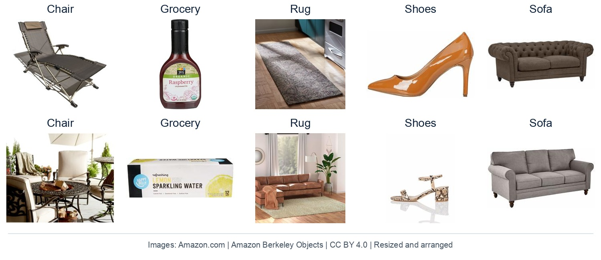

# Assignment 3 Dataset Proposal

**Course:** CO3133 — Deep Learning and Its Applications, Semester 261<br>
**Track:** Image–text classification<br>
**Dataset:** Amazon Berkeley Objects, five-class subset<br>
**Status:** Pending instructor approval

This proposal defines the dataset and experiment scope. Main experiments begin after instructor approval.



*Images © Amazon.com, from the [official ABO dataset](https://amazon-berkeley-objects.s3.us-east-1.amazonaws.com/index.html), [CC BY 4.0](https://creativecommons.org/licenses/by/4.0/). Ten training examples, two per class, resized and arranged with class labels for illustration. Dataset creators are credited in [1].*

## 1. Dataset and task

| Field | Specification |
|---|---|
| Source | [Official Amazon Berkeley Objects release](https://amazon-berkeley-objects.s3.us-east-1.amazonaws.com/index.html) [1] |
| Version | Official release accompanying the CVPR 2022 paper; metadata snapshot accessed 18 November 2026 |
| Usage/license | **CC BY 4.0** for listings and images. Credit Amazon.com and the dataset creators, link the license, and identify changes to reused material. [Official license](https://amazon-berkeley-objects.s3.us-east-1.amazonaws.com/LICENSE-CC-BY-4.0.txt). |
| Task | Single-label multimodal product-type classification |
| Input | One main catalog image and the original English title of the same product |
| Output | Chair, Grocery, Rug, Shoes, or Sofa |
| Prediction unit | One canonical product, identified by `item_id` |
| Annotation | Original `product_type` label; image joined through `main_image_id` |
| Formats | Gzip-compressed JSON Lines for listings; CSV image metadata; JPEG/PNG catalog images |
| Loss | Class-weighted cross-entropy; weights computed from training counts only and shared by all configurations |

ABO contains 147,702 product listings and 398,212 unique catalog images. Metadata includes multilingual names, product types, brands, model identifiers, and image IDs. The published license covers both listing metadata and images; the [AWS registry](https://registry.opendata.aws/amazon-berkeley-objects/) records the 2023 update to CC BY 4.0.

Image and text are linked by the same product record. No generated descriptions or independently matched images are used. Category fields, identifiers, brand/model grouping keys, and image labels added to the illustration are not supplied as model features. Only the original title and image are inputs.

**Citation:**

> Collins, Jasmine, et al. “ABO: Dataset and Benchmarks for Real-World 3D Object Understanding.” *CVPR*, 2022.

```bibtex
@inproceedings{collins2022abo,
  title = {ABO: Dataset and Benchmarks for Real-World 3D Object Understanding},
  author = {Collins, Jasmine and Goel, Shubham and Deng, Kenan and Luthra, Achleshwar
    and Xu, Leon and Gundogdu, Erhan and Zhang, Xi and Yago Vicente, Tomas F.
    and Dideriksen, Thomas and Arora, Himanshu and Guillaumin, Matthieu and Malik, Jitendra},
  booktitle = {Proceedings of the IEEE/CVF Conference on Computer Vision and Pattern Recognition},
  year = {2022}
}
```

## 2. Selected subset

Use records with an `en_US` title, a main-image reference present in the image metadata, and one consistent product-type label. Collapse marketplace copies by `item_id`, preferring `amazon.com`, then lexicographic domain order. Exclude item IDs with inconsistent labels across usable records.

The five categories are fixed before experimentation. There are 10,052 canonical candidate products in these categories. Group related products before selection; exclude mixed-category family components and cap Grocery at 3,000 using complete groups. This yields:

| Class | Pairs | Train | Validation | Test |
|---|---:|---:|---:|---:|
| Chair | 926 | 740 | 93 | 93 |
| Grocery | 3,000 | 2,480 | 260 | 260 |
| Rug | 639 | 511 | 64 | 64 |
| Shoes | 1,507 | 1,205 | 151 | 151 |
| Sofa | 281 | 225 | 28 | 28 |
| **Total** | **6,353** | **5,161** | **596** | **596** |

The scope exceeds the default of five classes and about 5,000 paired samples; it also has over 5,000 training pairs. Results apply only to this subset. Smaller subsets are debugging-only; record their size, seed, and purpose.

## 3. Distribution analysis and limitations

The preliminary audit checks all 16 listing shards and the image metadata. Detailed audit material and the provisional manifest are retained locally.

| Finding | Result |
|---|---|
| Source product listings / catalog images | 147,702 / 398,212 |
| Canonical candidate pairs in five classes | 10,052 |
| Mixed-category family groups excluded | 120 groups / 1,171 records |
| Selected pairs / product-family groups | 6,353 / 3,369 |
| Train / validation / test | 5,161 / 596 / 596 |
| Missing main-image metadata in candidate pool | 0 |
| Title words, min / median / max | 1 / 11 / 24 |
| Sample pairs retrieved and decoded | 10 / 10 |

Counts above establish metadata pairing, not full image integrity. Original-image metadata spans widths 166–3,000 and heights 70–2,560 pixels. The ten inspected downscaled examples are JPEG images with widths 118–256 and heights 95–256 pixels.

The illustration uses the first two SHA-256-ranked training products per class. Visual inspection found the broad product subjects consistent with their titles; two examples are multi-object room/seating scenes where the target is less isolated. These preliminary observations are not verified fine-grained product identities or a dataset-wide mismatch rate. Full image decoding, actual missing rates, aspect-ratio distributions, exact/perceptual duplicates, and representative label/pair-quality review remain part of data preparation.

The selected classes are imbalanced: Grocery has 3,000 pairs and Sofa 281. Titles may explicitly name the product type, making the text-only baseline strong. Report lexical shortcuts, packaging text, background/context cues, brand bias, and ambiguous room scenes. The 28 Sofa test pairs give less precise per-class estimates than larger classes; do not generalize to all ABO products or shopping domains.

## 4. Split and leakage prevention

The split unit is a connected product-family group. Connect canonical products sharing any catalog image ID, a normalized identical title, or an exact brand plus specific model-name/model-number value. Normalize with Unicode NFKC, case folding, and whitespace collapsing. Ignore empty/generic model values and values equal to the brand. Exclude family components spanning multiple target categories.

Rank each group by SHA-256 of `"42|" + group_id`, where `group_id` hashes its sorted product IDs. Keep all non-Grocery groups; add Grocery groups in rank order while their cumulative count is at most 3,000. Retain complete groups.

Apply `StratifiedGroupKFold(n_splits=10, shuffle=True, random_state=42)` to the product-ID-sorted selection. Fold 0 is test, fold 1 validation, and the other eight are training. The measured split is 5,161/596/596; grouping takes priority over exact 80/10/10 proportions. The provisional allocation was generated with scikit-learn 1.9.1. All five classes occur in every partition; no family group spans partitions.

Store product/marketplace IDs, main-image IDs, group IDs, folds, split, and exclusion reasons in a versioned manifest. All images, marketplace copies, and cached features of a retained product inherit its split. Before training, quarantine further invalid records and keep additional confirmed duplicate groups together; revise/freeze the final manifest before any experiment. Review material changes with the instructor.

Fit learned statistics and loss weights using training data only. Do not use test data for tuning, early stopping, checkpoint selection, or deciding which categories to retain. Use the same manifest for every configuration.

## 5. Preprocessing pipeline

```text
Product record → validate title/image pair → family-group split
               → RGB preprocessing + tokenizer → paired DataLoader
               → image/text encoders → unimodal head or fusion
               → cross-entropy → optimization → prediction → evaluation
```

- Convert images to RGB; resize with preserved aspect ratio and pad on white to `224 × 224`, then apply ImageNet normalization. Image tensor: `(B, 3, 224, 224)`.
- Use the original `en_US` title with the DistilBERT uncased tokenizer [3], maximum 64 tokens, attention masks, padding, and truncation. IDs/masks: `(B, L)`, `L ≤ 64`. Measure token lengths and truncation rates.
- Pair both modalities through the same canonical product/main-image identifiers.
- Use deterministic preprocessing and no augmentation for the core comparison. Validate image formats from decoded content, not file suffixes.
- Exclude missing/corrupt inputs from the paired benchmark; never replace them with unrelated records. Validation/test perform no gradient updates.

## 6. Models and controlled experiment

Use PyTorch training primitives, torchvision ResNet-18 [2], and Transformers DistilBERT [3]. The group will implement pooling, projections, heads, fusion, training, and evaluation.

| Configuration | Planned method |
|---|---|
| Image only | Frozen ImageNet ResNet-18; pooled 512-dimensional features and five-class linear head |
| Text only | Frozen DistilBERT; attention-mask-aware mean-pooled 768-dimensional features and five-class linear head |
| Simple fusion | Intermediate fusion: concatenate features; 256-unit ReLU MLP and classifier |
| Improved fusion | Intermediate fusion: project both modalities to 256 dimensions; learned sigmoid gate and classifier [4] |
| Gate ablation | Same projection/classifier design, with equal fixed modality weights |

Train unimodal heads separately, then fusion heads on the same frozen encoder features. Keep both encoders in evaluation mode, including BatchNorm buffers/dropout. Backbone fine-tuning is outside the core scope. Each configuration's overall loss is supervised cross-entropy with training-only weights `N_train / (5 × n_class)`; there is no auxiliary encoder loss.

Gated fusion uses `h = g * h_image + (1 - g) * h_text`. Its controlled ablation fixes `g = 0.5` and retrains the remaining head; report the parameter-count difference.

Initial settings: AdamW, learning rate `1e-3`, weight decay `1e-4`, batch size 32, and at most 20 epochs per configuration. Reset Python, NumPy, CPU/CUDA, and DataLoader seeds to `42` before each run. Select highest validation macro-F1, then lower validation loss, then earlier epoch.

| Comparison | Hypothesis / changed factor | Fixed factors | Decision criterion |
|---|---|---|---|
| Image vs. text | Modalities differ in predictive strength; modality and encoder change | Split, labels, metrics, seed, selection | Validation macro-F1 and final test metrics with compute cost; not an isolated architecture test |
| Unimodal vs. concatenation | Combined features may help ambiguous titles; inputs/head change | Same encoders, preprocessing, split, evaluation | Validation macro-F1; whether test findings agree |
| Concatenation vs. gated fusion | Adaptive weighting may help conflicting evidence; fusion changes | Encoder features, split, seed, loss weights, optimizer, budget, selection | Validation macro-F1, final test metrics, capacity/compute |
| Learned vs. fixed gate | Adaptive weights contribute beyond equal weighting; gate changes | Projection/classifier design, features, split, seed, schedule | Validation macro-F1, final test metrics, parameter/time differences |

## 7. Evaluation and error analysis

**Primary metrics:** accuracy and macro-F1. Report per-class precision/recall/F1, confusion matrices, learning curves, correct/difficult-correct/failed examples, and the fixed test-set support per class. Evaluate selected checkpoints once on test after model selection.

Compare unimodal and multimodal results, including cases where both modalities agree, one rescues the other, or they conflict. Analyze room scenes with several products, visually similar furniture, short/ambiguous titles, category words, packaging text, and minority-class errors. Fusion is not required to outperform either modality; explain outcomes with evidence.

Missing-modality diagnostics zero the removed projected representation and bypass its gate contribution. These are inference interventions, not independently trained baselines or a missing-modality-trained model. Both modalities absent → abstain.

**Secondary measurements:** total/trainable parameters, feature-extraction and head-training time, warmed-up model-only and end-to-end latency, and peak allocated GPU memory. End-to-end cost includes preprocessing, tokenization, encoders, and head; record batch size, hardware, timing boundaries, and synchronization.

## 8. Compute and reproducibility

| Item | Plan |
|---|---|
| Resolution/batch | `224 × 224` RGB; up to 64 text tokens; batch size 32 |
| Hardware | One GPU with approximately 8 GB memory; record actual hardware |
| Schedule | Five configurations, up to 20 epochs each |
| Runs/time | Approximately 1–3 GPU-hours including feature extraction; estimate to validate with a pilot |
| Storage | 10 GB budget for metadata, selected images, weights, caches, and checkpoints; no 3D/turntable data required |
| Memory control | Frozen encoders, deterministic cached features, microbatch extraction if needed |
| Provenance | Source metadata hashes, manifest, image hashes, software/dependency versions, pretrained revisions, configs, seeds, epoch logs, run IDs, checkpoint hashes, and commit/tag |
| Reconstruction | Publish preparation, train/evaluate, checkpoint-reconstruction commands and final provenance with implementation |

Main implementation begins only after **Approved** or **Approved with conditions**. Record any instructor conditions. Final report, slides, video, and checkpoints/reconstruction instructions will accompany the later milestones; no model results or approval are claimed here.

## References

1. Collins, J., Goel, S., Deng, K., Luthra, A., Xu, L., Gundogdu, E., Zhang, X., Yago Vicente, T. F., Dideriksen, T., Arora, H., Guillaumin, M., and Malik, J. “ABO: Dataset and Benchmarks for Real-World 3D Object Understanding.” *CVPR*, 2022. [Paper](https://arxiv.org/abs/2110.06199); [dataset and attribution](https://amazon-berkeley-objects.s3.us-east-1.amazonaws.com/index.html).
2. He, K., Zhang, X., Ren, S., and Sun, J. “Deep Residual Learning for Image Recognition.” *CVPR*, 2016. [Paper](https://arxiv.org/abs/1512.03385); [ResNet-18](https://docs.pytorch.org/vision/stable/models/generated/torchvision.models.resnet18.html).
3. Sanh, V., Debut, L., Chaumond, J., and Wolf, T. “DistilBERT, a distilled version of BERT: smaller, faster, cheaper and lighter.” 2019. [Paper](https://arxiv.org/abs/1910.01108); [model/tokenizer](https://huggingface.co/distilbert/distilbert-base-uncased).
4. Arevalo, J., Solorio, T., Montes-y-Gomez, M., and Gonzalez, F. A. “Gated Multimodal Units for Information Fusion.” 2017. [Paper](https://arxiv.org/abs/1702.01992).
